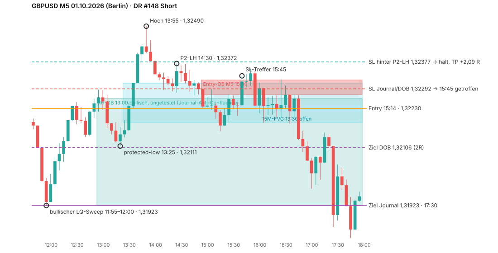

# LQ 2.0: Was macht einen guten Liquiditäts-Sweep aus?

> **Entscheidung (Philip, 22.11.2026): Variante B.** Ein LS ist stark, wenn der Impuls ≥ 0,85 H1-ATR ist, mindestens
> 1 Swing gebrochen wird und der LS ein LH nach LL ist (Long gespiegelt). Einen Asia-Ausschluss gibt es nicht.
> Gegen die Reaktion gemessen (H1/H2 2026): Lift 1,47/1,46, Recall 24/26 %. Die Regel behält 12–14 % der Sweeps ohne
> Reaktion. Alle 5 Mustertrade-Pins (623, 624, 625, 626, 629) bleiben drin. Die Schwelle 0,85 ist an Pin 626
> festgemacht. Umsetzung im Chart: Session liq-2-chart.

Stand 21.11.2026. Reine Analyse: kein Produktivcode, keine DB-Schreibzugriffe. Alle Zeiten Berlin.
Grundgesamtheit: alle gesweepten LQ-1.0-Level 2026 (M5, Fraktal P5, Spread Hour ignoriert) aus `fxcm_candles`,
05.01. bis 21.11.2026, GBPUSD, EURUSD und XAUUSD. Halbjahre: H1 = Jan–Jun, H2 = Jul–Nov (Berliner Monat).

Reproduktion (Rohdaten in `local-data/lq2-sweeps/`, nicht eingecheckt):
1. `node analysis/lq2-sweeps/sammle.mjs`: DB paginiert lesen, M5-Kerzen einmal je Instrument.
2. `node analysis/lq2-sweeps/elternTrend.mjs <INSTRUMENT> <DOB-Cache-Ordner>`: TS1.1-Kette (Wurzel und aktuelle Ebene),
   stündlich aus vorhandenen DOB-Kerzen-Caches. Keine DB, ca. 45 s je Instrument.
3. `node analysis/lq2-sweeps/reaktion.mjs` → `reaktion.json` (Hauptergebnis) und `node analysis/lq2-sweeps/auswerte.mjs`
   → `ergebnis.json` (Trade-Ebene und Positiv/Zufall). Die gemeinsame Merkmalsberechnung steht in `merkmale.mjs`.

## Kurzfassung

1. **Die Trade-Winrate taugt nicht als Zielgröße.** Über alle 5 LQ-Sweep-Läufe (4043 Trades mit M5-LS) trennt kein
   LS-Merkmal Gewinner von Verlierern in beiden Halbjahren. Entry, SL und DOB überdecken die Sweep-Qualität.
2. **Die Reaktion nach dem Sweep taugt.** Das sind 17.751 Sweeps mit Rückschluss. Mehrere Merkmale, die vor dem Sweep
   feststehen, sagen eine starke Reaktion in beiden Halbjahren und allen drei Instrumenten vorher: **Impuls in H1-ATR**
   (AUC 0,70/0,71), **Alter des LS** (0,63/0,66), **gebrochene Swings** (0,62/0,64) und **Sweep in NY statt Asia**.
3. **Philips Auswahl bestätigt die Zielgröße.** Von 11 Pins hat keiner „keine Reaktion“, bei den Journal-Gewinnern ist
   es 1 von 28. Im Durchschnitt aller Sweeps sind es 32 %.
4. **Was nicht trennt:** „LH nach LL“ (Lift 1,0), die Richtung der Elternebene (Wurzel und aktuelle Ebene, Lift 1,0),
   die M5/M15-OB-Kante (1,0) und der Abstand zum nächsten Kandidaten. Die heutige LQ-2.0-Regel ist nur schwach
   (Lift 1,3, behält 21 % der starken Reaktionen).

## Zielgröße „Reaktion“

- **Sweep-Zone:** 30 min ab dem ersten Touch. Ein Sweep läuft oft über mehrere Kerzen. Bei DR #145 berührt die
  11:40-Kerze den LS, schließt aber sofort zurück, und 11:45 sticht noch 3 Pips höher. Das Zonen-Extrem ist deshalb die
  Re-Sweep-Grenze.
- **Durchbruch:** kein M5-Schluss zurück hinter den LS innerhalb der Zone. Das ist kein Sweep und gehört nicht zur
  Grundgesamtheit (GBP 1605, EUR 1638, XAU 1500).
- **MFE:** ab dem Touch, vom LS weg, in H1-ATR zum Sweep-Zeitpunkt, bis zum Re-Sweep. **Stark:** MFE ≥ 1,5 ATR in 3 h.
  **Keine:** Re-Sweep, bevor 0,5 ATR erreicht sind. Dazwischen liegt „mittel“.

| | n | stark H1 / H2 | keine H1 / H2 |
|---|---|---|---|
| GBPUSD | 5985 | 14,1 / 16,6 % | 34,5 / 31,6 % |
| EURUSD | 5890 | 14,1 / 14,7 % | 32,3 / 32,3 % |
| XAUUSD | 5876 | 14,7 / 16,5 % | 30,8 / 32,9 % |

MFE-Verteilung (alle, H1-ATR): 1 h Median 0,55 (Q75 0,91, Q90 1,39) · 3 h 0,62 (1,11 / 1,85) · bis Sessionende 0,62
(1,14 / 1,98). Ein Re-Sweep kommt bei 40 % innerhalb 1 h und bei 56 % innerhalb 3 h. Bei 1,5 ATR in 3 h sind 15 % stark.

## Merkmale: stark gegen keine (alle Instrumente, AUC bzw. Lift H1 / H2)

„Trennt“ heißt |AUC − 0,5| ≥ 0,05 und p < 0,01 in beiden Halbjahren, mit gleicher Richtung.

| Merkmal (vor dem Sweep bekannt) | H1 | H2 | trennt | auch je Instrument |
|---|---|---|---|---|
| Impuls vom LS in H1-ATR | AUC 0,70 | 0,71 | ja | GBP, EUR, XAU |
| Alter des LS | 0,63 | 0,66 | ja | GBP, EUR, XAU |
| gebrochene Swings im Impuls | 0,62 | 0,64 | ja | GBP, EUR, XAU |
| Impulsdauer | 0,61 | 0,63 | ja | GBP, EUR, XAU |
| Rang unter aktiven Kandidaten | 0,60 | 0,61 | ja | GBP, EUR, XAU |
| BOS vor dem Sweep | Lift 1,31 | 1,34 | ja | GBP, EUR, XAU |
| Sweep in NY | Lift 1,45 | 1,62 | ja | GBP, EUR, XAU |
| Sweep in Asia | Lift 0,67 | 0,63 | ja (negativ) | GBP, EUR |
| LQ 2.0 heute (LH nach LL + BOS ≤ 2 h) | Lift 1,33 | 1,30 | schwach (AUC 0,53) | – |
| LH nach LL | 1,01 | 1,04 | nein | – |
| mit der Wurzel (TS1.1) | 1,00 | 0,98 | nein | – |
| mit der aktuellen Ebene (TS1.1) | 0,97 | 0,96 | nein | – |
| M5- bzw. M15-OB-Kante (Pip) | 1,00 / 0,92 | 0,99 / 1,03 | nein | – |
| Abstand zum nächsten Kandidaten | AUC 0,51 | 0,50 | nein | – |

Nachlaufend, darum nicht in der LS-Regel:
- Spanne der Sweep-Kerze: AUC 0,79/0,82. Sie steckt zum Teil selbst in der MFE und taugt als Entry-Auslöser.
- Gegen-FVG direkt nach dem Sweep: Lift 1,68/1,95.
- Session-High/-Low: Lift 1,54/1,56. Der Wert kennt das Session-Ende.

## Regeln (nur Merkmale vor dem Sweep)

P = Precision (Anteil stark), R = Recall (Anteil der starken behalten), keine = Anteil der „keine“-Sweeps, die die Regel
behält. Basis stark: 14,3 / 15,9 %. Werte für alle drei Instrumente; je Instrument steht es in `reaktion.json`.

| Regel | P H1 / H2 | R H1 / H2 | Lift | keine behalten |
|---|---|---|---|---|
| LQ 2.0 heute | 19,0 / 20,8 | 20,8 / 21,5 | 1,33 / 1,30 | 14 / 15 % |
| Impuls ≥ 1 ATR | 19,9 / 22,6 | 62,8 / 65,6 | 1,39 / 1,42 | 34 % |
| Impuls ≥ 1,5 ATR | 22,1 / 24,1 | 38,8 / 40,0 | 1,55 / 1,51 | 16 / 17 % |
| Alter ≥ 10 h | 23,0 / 26,3 | 32,4 / 36,8 | 1,61 / 1,65 | 13 % |
| **Impuls ≥ 1 ATR & ≥ 1 Swing & Sweep nicht Asia** | **21,4 / 26,0** | **42,4 / 47,8** | **1,50 / 1,63** | **19 %** |
| LH nach LL & Impuls ≥ 1 ATR & Sweep nicht Asia | 20,2 / 24,5 | 22,8 / 26,4 | 1,41 / 1,54 | 11 / 13 % |

Die gierige Suche auf H1 (geprüft auf H2) findet mit Merkmalen vor dem Sweep keine bessere Kombination als Impuls oder
Alter allein (Lift 1,6–1,7). Darf sie die Sweep-Kerze nutzen, kommt „Spanne ≥ 0,64 ATR & Impuls ≥ 1,1 ATR & Sweep nicht
13–14/22–23 Uhr“ heraus (Lift 2,4 / 2,5). Das ist aber ein Entry-Auslöser, keine LS-Bewertung.

## Gegenprobe

| Regel | Pins | Journal + | Journal − | DR #145 15:45, P557 07:45 | 19:40 raus? |
|---|---|---|---|---|---|
| LQ 2.0 heute | 5/11 | 12/28 | 1/5 | 2/2 | ja |
| Impuls ≥ 1 ATR | 8/11 | 12/28 | 2/5 | 2/2 | nein |
| Impuls ≥ 1 ATR & ≥ 1 Swing & Sweep nicht Asia | 5/11 | 9/28 | 2/5 | 2/2 | **nein** (1,5 ATR, 1 Swing, Sweep London) |
| LH nach LL & Impuls ≥ 1 ATR & Sweep nicht Asia | 4/11 | 9/28 | 1/5 | 2/2 | ja |

Reaktionsklasse der Prüffälle:
- Pins: 5/11 stark, 0/11 keine.
- Journal-Gewinner: 7/28 stark, 1/28 keine.
- DR #145 15:45: „mittel“ (1,28 ATR in 3 h; der große Abgang kam erst nach 15:45).
- P557: stark (1,51).
- 19:40: „mittel“ (0,91).

## Vorschlag

- **LQ-2.0-Kern aus den Daten:** Impuls ≥ 1 H1-ATR, mindestens 1 gebrochener Swing, Sweep nicht in Asia. Die Regel
  ist in beiden Halbjahren und allen Instrumenten stabil (Lift 1,45–1,77). Sie behält knapp die Hälfte der starken
  Reaktionen und wirft vier Fünftel der „keine“-Sweeps raus.
- **Strukturfrage für Philip:** Mit „LH nach LL“ fällt 19:40 raus, und DR #145 und P557 bleiben drin. Die Daten zeigen
  dafür aber keinen Mehrwert: Der Recall halbiert sich, die Precision steigt nicht. Ob die Struktur Pflicht wird, ist
  eine fachliche Entscheidung.
- **Streichen als LS-Kriterium:** BOS ≤ 2 h (zu streng, schwach), OB-Kante, Elterntrend.
- **Grenzen:** Die Regel behält nur 5 von 11 Pins und 9 von 28 Journal-Gewinnern, obwohl diese fast nie scheitern.
  Philips Auge sieht also mehr als diese Merkmale. Die Gold-Journal-Gewinner haben oft nur 0,6–0,9 ATR Impuls.

## Zweite Quelle: M5-OB-Kanten (`obQuelle` in `reaktion.json`)

Die OB-Kanten stammen aus `setup1ObLiquidityLevels` (`detectOrderBlockLiquidityLevels`, dieselben OBs wie der Chart-Toggle
„OB Sweeps“). Zeitraum, Zone und Klassen sind dieselben wie bei den Pivots. Rang und Abstand zum nächsten Kandidaten
entfallen hier, weil die Quelle nur berührte Kanten kennt. Eine OB-Kante, die auf demselben Preis (±1 Tick) zur selben
Zeit gesweept wird wie ein Pivot, zählt als „Pivot“.

| alle Instrumente | n H1 / H2 | stark H1 / H2 | keine H1 / H2 | MFE-Median 3 h |
|---|---|---|---|---|
| Pivot (alle) | 9715 / 8036 | 14,3 / 15,9 % | 32,5 / 32,3 % | 0,61 / 0,62 |
| Pivot ohne OB-Kante | 5387 / 4227 | 13,9 / 15,7 % | 32,8 / 33,5 % | 0,61 / 0,61 |
| Pivot auf OB-Kante | 4328 / 3809 | 14,8 / 16,2 % | 32,2 / 30,8 % | 0,62 / 0,64 |
| OB-Kante, kein Pivot | 10593 / 8383 | 15,1 / 16,2 % | 31,7 / 32,4 % | 0,63 / 0,62 |

- **OB-Kanten reagieren nicht besser als Pivots.** Der Unterschied liegt bei höchstens einem Prozentpunkt und ist nicht
  in beiden Halbjahren signifikant. Das gilt auch je Instrument (GBP, EUR, XAU): Abstand ≤ 1,5 Prozentpunkte, in
  wechselnder Richtung. Auch der Durchbruch-Anteil ist gleich, rund 21 % bei beiden Quellen.
- Innerhalb der reinen OB-Sweeps trennen dieselben Merkmale in beiden Halbjahren: Impuls (AUC 0,70/0,68), Alter
  (0,62/0,62), Swings (0,60/0,61) und Sweep in NY (Lift 1,43/1,57), Asia gegenläufig. Die Elternebene trennt
  wieder nicht.
- Dieselbe Regel (Impuls ≥ 1 ATR & ≥ 1 Swing & Sweep nicht Asia) bringt bei OB-Kanten Lift 1,41/1,46 bei Recall
  45/50 %. Sie lässt sich also für beide Quellen gleich verwenden.
- Bei den Pins liegt der LS seltener auf einer M5-OB-Kante (4/11) als im Zufall (47 %). Die Vermutung „gute Sweeps sind
  eher OB-Kanten“ bestätigen die Daten damit nicht.

## Frühere Auswertung (Positiv/Zufall, `ergebnis.json`)

- Pins gegen Zufall zeigten dieselbe Richtung: größerer Impuls (1,22 gegen 0,94 ATR) und älterer LS (4 gegen 1,9 h).
- Was in den Läufen „Positiv gegen Zufall“ trennte (LH nach LL, Rückschluss), steckte genauso in den Verlierern. Das
  ist die TS1.1-Vorauswahl.
- Lauf-LS (erster Trade je LS): GBP v0 462, v1 321, EUR v0 447, XAU v0 398, v1 268.
- Journal-DR ohne LS: #112, #134, #136.
- Ohne LQ-1.0-Gegenstück: EUR DR #94, XAU TS 50160/DR #140.
- Die HTF-OB-Läufe (`dob-setup-*`) haben keinen TS1.1-Link und damit keinen LS.

## Einzelfall DR #148 (Position 177): FVG-Anti-Confluence R1–R6

GBPUSD Short, 01.10.2026, Zeiten Berlin (CEST). Entry 15:14 bei 1,32230 am bärischen M5-OB 15:00 (1,32274–1,32320).
Laut Journal: SL 1,32292, Exit 17:34 bei 1,31923 als Win, Invalidierung 1,3266. H1-ATR beim Entry 18,7 Pips.
Gerechnet mit `fallDr148.mjs` → `fall-dr148.json`, das Diagramm mit `svgDr148.mjs`. Nur lokale Kerzen.

**Bullische Kräfte beim Entry** (Stand 15:10, nur geschlossene Kerzen; Abstand vom Entry nach unten):

| Art | Zeit | Zone/Preis | Abstand | Zustand |
|---|---|---|---|---|
| 1H-OB (Journal-Anti-Confluence, `ob_zones` 4863827) | 13:00 | 1,31923–1,32261 | Entry liegt darin | ungetestet |
| 15M-FVG (A) | 13:30 | 1,32186–1,32310 | Entry liegt darin, direkt unter dem Entry-OB | angelaufen, nicht durchlaufen |
| 5M-FVG (A) | 13:35 | 1,32193–1,32231 | 0 Pips | angelaufen, nicht durchlaufen |
| 15M-OB (B) | 13:30 | 1,32138–1,32186 | 4,4 Pips / 0,23 ATR | ungetestet |
| 5M-OB (B) | 13:35 | 1,32111–1,32193 | 3,7 Pips / 0,20 ATR | ungetestet |
| 15M-FVG (A) / 15M-OB (B) | 12:15 | 1,32078–1,32180 / 1,32034–1,32078 | 5,0 / 15,2 Pips | angelaufen / ungetestet |
| 5M-FVG (A) / 5M-OB (B) | 12:10 | 1,32023–1,32034 / 1,31923–1,32023 | 19,6 / 20,7 Pips | offen / ungetestet |
| protected-low der inneren Aufwärts-Ebene | 13:25 | 1,32111 | 11,9 Pips / 0,63 ATR | nicht gebrochen |
| bullischer LQ-Sweep (Tief 12:00) | 11:55 | holt die Tiefs 29.09. 17:25–19:55 und 01.10. 11:00 (1,32017–1,32084), Tief 1,31923 | 14,6–21,3 Pips / 0,8–1,1 ATR | nicht sauber gebrochen |

**R1–R6:**
- **R1 greift:** Eine offene Gegen-FVG (15M 13:30) liegt direkt unter bzw. im Entry-OB. In Variante B gilt dasselbe für
  den ungetesteten 1H-OB 13:00, in dem der Entry selbst liegt. Beide Varianten würden den Trade sperren.
- **R2 hängt an „direkt vor dem Kurs“:** Der bullische LQ-Sweep 11:55 ist nicht sauber gebrochen, liegt aber 0,8–1,1 ATR
  unter dem Entry und ist zugleich das Ziel. Bei einer Grenze von ≤ 0,5 ATR greift R2 nicht.
- **R3 hebt nichts auf:** Bis zum Entry gibt es keinen Schluss unter das protected-low 13:25 und keinen unter das Sweep-Tief.
- **R4 ist erfüllt:** Nach der aktivierten bullischen Kraft (Sweep 11:55, Anstieg bis 13:55) gibt es mit dem M5-OB 15:00
  einen neuen eigenen bärischen OB.
- **R5 passt:** Die offenen FVGs um den Entry werden nach dem Entry angelaufen, mit einem Rücklauf bis 1,32356 (15:55).
  Die tieferen bei 12:10/12:15 holt der Kurs um 16:55–17:05 (Tief 1,31976 um 17:05) und prallt bis 1,32154 (17:20) ab.
- **R6 rettet den Trade:** Der bärische P2-LH ist das Hoch 14:30 bei 1,32372 (Fraktal P2, LH unter dem Hoch 13:55 bei
  1,32490). Der Struktur-Algo führt ihn nur als „high“, nicht als protected-high. Zum Entry sieht er eine Abwärts-Wurzel
  und darin eine innere Aufwärts-Ebene mit protected-low 1,32111.

**SL-Simulation ab der Entry-Kerze** (gleiche Kerze für SL und Ziel zählt konservativ als SL):

| SL | Risiko | Ziel Journal 1,31923 | Ziel DOB 1,32106 |
|---|---|---|---|
| 1,32292 (Journal und DOB) | 6,2 Pips | SL 15:45 | SL 15:45 (DOB-Lauf: 15:48) |
| **1,32377 (0,5 Pip über P2-LH 14:30)** | **14,7 Pips** | **TP 17:30, +2,09 R** | TP 16:55, +0,84 R |
| 1,32495 (über dem Hoch 13:55) | 26,5 Pips | TP 17:30, +1,16 R | TP 16:55, +0,47 R |
| 1,3266 (Invalidierung) | 43 Pips | TP 17:30, +0,71 R | TP 16:55, +0,29 R |

Das höchste Hoch zwischen Entry und Ziel liegt bei 1,32356 (15:55), 1,6 Pips unter dem P2-LH. Damit hält der SL.

**DOB-Läufe:** Den Trade gibt es identisch in `dob-lq-sweep-gbpusd-v0`, `-v1` (POI TS 10056) und `dob-setup-gbpusd-v0`:
Entry a 15:14 bei 1,32230, SL 1,32292, Ziel 1,32106 (2R). Ergebnis **Loss** um 15:48, max_r 1.
Ein zweiter Entry 17:32 bei 1,31999 ist dort `unknown`.

**Widerspruch im Journal:** Position 177 hat SL 1,32292 und Outcome „win“. Mit diesem SL wäre sie um 15:45 ausgestoppt
worden. Der eingetragene SL ist offenbar der DOB-SL. Philips realer SL lag nach seiner Aussage auf dem P2-LH; dann
stimmt das Win mit 2,09 R.

## SL statt Sperre: FVG-Anti-Confluence auf den DOB-Läufen 2026

Frage (Philip, 22.11.): Gewinnt man mehr, wenn die Anti-Confluence den Trade nicht sperrt, sondern den SL hinter den nächsten
Strukturpunkt legt (Vorbild DR #148)? Skripte `sammleDob.mjs` (Trades und News lesen) und `slStattSperre.mjs` →
`sl-statt-sperre.json`. Ausgewertet sind die jüngsten Läufe je Asset: LQ-Sweep GBP v1, EUR v0, XAU v1 und HTF-OB v3. Nur
abgeschlossene Trades bis 20.11.

> **Korrigiert am 23.11.:** Die erste Fassung zählte „getestet“ bzw. „durchlaufen“ ab der Startzeit der berührenden Kerze.
> Eine M15/H1-Zone galt dadurch beim Entry schon als erledigt, obwohl die Kerze noch lief (DR #148: der 1H-OB 13:00 fehlte).
> Jetzt zählt der Schluss der berührenden Kerze. Damit kippt das Fazit: Die Sperre ist nicht mehr die einzige stabile
> Variante, und (c) M15 liegt in der Winrate in jedem Halbjahr vorn.

**Treffer (R1, Varianten A/B):**
- Eine bullische (Short) bzw. bärische (Long) Zone auf M5/M15/H1 aus den letzten 2 Tagen. Sie ist beim Entry offen (FVG nicht
  vollständig durchlaufen = A) bzw. ungetestet (OB = B), liegt zwischen Ziel und Entry, und ihre Kante liegt höchstens
  0,5 H1-ATR hinter dem Entry.
- **Streng:** Der Entry liegt in der Zone selbst.
- Die breite Definition trifft 66–76 % aller Trades, die strenge 25–26 %.

**Varianten:**
- (a) wie gelaufen: DOB-Ergebnis, Ziel-R oder −1.
- (b) gesperrt: 0 R.
- (c) SL 5 Ticks hinter den letzten bestätigten, bis zum Entry unberührten P2-Swing (M5 oder M15) der letzten 2 Tage, jenseits
  des DOB-SL. Das Ziel bleibt, R wird neu berechnet.
- **Proxy-Hinweis:** Der Struktur-Algo markiert solche LH nicht als protected (DR #148: 14:30 nur „high“), deshalb P2-Fraktale.
- Bei jedem Treffer gab es einen solchen Swing. Der SL wird dadurch im Median 1,5-mal so groß.
- Die eigene M5-Simulation stimmt bei 97 % der Trades mit dem DOB-Ergebnis überein.

Werte als ΣR · WR · Max-DD (R):

| Gruppe | Treffer | (a) wie gelaufen | (b) gesperrt | (c) M5-Swing | (c) M15-Swing |
|---|---|---|---|---|---|
| LQ-Sweep GBP v1 | 588/868 | −16 · 32,7 % · 80 | −19 · 31,1 % · 40 | −36 · 40,7 % · 77 | −22 · 45,9 % · 66 |
| LQ-Sweep EUR v0 | 724/1089 | −6 · 33,1 % · 58 | +19 · 35,1 % · 19 | +18 · 43,0 % · 41 | +6 · 47,8 % · 42 |
| LQ-Sweep XAU v1 | 405/534 | +45 · 36,1 % · 26 | +12 · 36,4 % · 24 | +30 · 43,1 % · 25 | +39 · 49,1 % · 26 |
| HTF-OB GBP v3 | 268/363 | −18 · 31,7 % · 47 | −11 · 29,5 % · 17 | +4 · 43,5 % · 15 | +19 · 50,1 % · 14 |
| HTF-OB EUR v3 | 206/296 | +4 · 33,8 % · 32 | +12 · 37,8 % · 9 | +7 · 43,2 % · 22 | −2 · 46,6 % · 26 |
| HTF-OB XAU v3 | 387/521 | +40 · 35,9 % · 31 | +37 · 42,5 % · 13 | +48 · 44,0 % · 28 | +59 · 50,1 % · 20 |
| **alle LQ-Sweep** | 1717/2491 | +23 · 33,6 % · 63 | +12 · 33,9 % · 40 | +12 · 42,2 % · 76 | +22 · 47,4 % · 70 |
| **alle HTF-OB v3** | 861/1180 | +26 · 34,1 % · 62 | +38 · 37,3 % · 17 | +59 · 43,6 % · 45 | +75 · 49,2 % · 36 |

Nach Halbjahr H1 / H2, als WR und ΣR:

| Gruppe | (a) | (b) | (c) M15 |
|---|---|---|---|
| alle LQ-Sweep | 33,9 / 33,3 % · +24 / −1 | 35,0 / 32,5 % · +21 / −9 | **47,9 / 46,7 %** · +40 / −18 |
| alle HTF-OB v3 | 32,1 / 37,2 % · −27 / +53 | 37,9 / 36,5 % · +25 / +13 | **47,9 / 51,4 %** · +18 / +57 |

**Ergebnis:**
- **(c) M15 hebt die Winrate stabil auf 46–53 %**, in jedem Lauf und jedem Halbjahr. Bei den getroffenen Trades steigt sie von
  33 auf 53–54 %.
- **HTF-OB:** (c) M15 ist in ΣR in beiden Halbjahren besser als (a). Gegenüber der Sperre liegt es nur insgesamt (+75 gegen
  +38 R) und in H2 vorn, in H1 nicht (+18 gegen +25 R). Der Max-DD (36 R) ist doppelt so groß wie bei der Sperre (17 R).
- **LQ-Sweep:** Keine Variante ist in beiden Halbjahren positiv. (c) M15 verliert in H2 18 R, vor allem GBP und EUR.
- **Gegenprobe DR #148:** Der Trade ist ein Treffer (A, B und streng). (c) M5 macht ihn zum Win: SL 1,32377 hinter P2 14:30,
  Ziel um 16:55, +0,84 R mit dem DOB-Ziel 2R (+2,09 R mit Philips Ziel). (c) M15 macht ihn ebenfalls zum Win: SL 1,32495
  hinter dem Swing 13:45, +0,47 R.

## c-losses: Wo verliert (c) M15?

Skript `cLosses.mjs` → `c-losses.json`, nur lokale Daten. Zielmaß ist die Winrate (Philip: TPs per Hand). Der H1-Trend kommt
aus `dobOuterTrend` (H1, 10 Tage). Die LS-Güte nach LQ 2.1 gibt es nur bei LQ-Sweep-Trades mit M5-LS. News-Nähe heißt ein
GBP/EUR/USD-Termin von 1 h vor bis 2 h nach dem Entry; `news_events` hat für 2026 nur 84 Einträge.

**Max-DD von (c) M15:**

| Familie | Max-DD | Zeitraum (Berlin) | Trades | WR darin | Anteil je Asset |
|---|---|---|---|---|---|
| LQ-Sweep | 69,5 R | 10.07. 20:19 → 22.09. 10:56 | 518 | 41,1 % | EUR −32 R (201 T, 40,8 %) · GBP −28 R (193 T, 39,4 %) · XAU −9 R (124 T, 44,4 %) |
| HTF-OB v3 | 35,9 R | 15.01. 20:11 → 06.03. 19:33 | 210 | 39,0 % | XAU −15 R (84 T, 34,5 %) · EUR −15 R (45 T, 31,1 %) · GBP −6 R (81 T, 48,1 %) |

- **LQ-Sweep:** Der DD ist eine Sommerphase (Juli bis September, Schwerpunkt August mit 221 Trades). Je Asset: GBP läuft von
  27.02. bis 08.09. 66 R ins Minus (WR 42 %), mit dem schlechtesten Monat August (35 %, −29 R). EUR 13.07. → 17.11. 42 R,
  XAU 29.06. → 21.10. 26 R.
- **HTF-OB:** Der DD liegt im Januar und Februar (Februar 141 Trades). XAU Januar 28 % WR, EUR Februar und März 43–48 %.

Monatliche WR von (c) M15 (alle Trades, ΣR in Klammern):

| Asset · Familie | Jan | Feb | Mär | Apr | Mai | Jun | Jul | Aug | Sep | Okt | Nov |
|---|---|---|---|---|---|---|---|---|---|---|---|
| GBP LQ | 54 % (+15) | 48 % (0) | 46 % (−10) | 43 % (−10) | 42 % (−9) | 43 % (−7) | 51 % (+9) | **35 % (−29)** | 51 % (+11) | 56 % (+21) | 33 % (−14) |
| EUR LQ | 50 % (+12) | 40 % (−16) | 49 % (−2) | 53 % (+23) | 55 % (+15) | 44 % (−10) | 54 % (+7) | 43 % (−4) | 41 % (−11) | 47 % (0) | 44 % (−7) |
| XAU LQ | – | 46 % (+5) | 55 % (+5) | 48 % (+6) | 52 % (+14) | 48 % (+11) | 46 % (−5) | 39 % (−10) | 59 % (+7) | 44 % (−10) | 57 % (+17) |
| GBP HTF | 65 % (+9) | 49 % (−2) | 43 % (−6) | 56 % (+11) | 45 % (0) | 17 % (−13) | 54 % (+11) | 62 % (+7) | 46 % (+1) | (1 T) | 50 % (0) |
| EUR HTF | 50 % (+2) | 48 % (+2) | 43 % (−7) | 47 % (0) | 46 % (0) | 46 % (−3) | 42 % (−3) | 42 % (−2) | 61 % (+7) | 42 % (−3) | 56 % (+5) |
| XAU HTF | 28 % (−7) | 39 % (0) | 44 % (−5) | 59 % (+9) | 47 % (+2) | 64 % (+25) | 47 % (+2) | 46 % (+3) | 54 % (+3) | 53 % (+7) | 68 % (+19) |

**Losses gegen Wins:** Grundlage sind die 2.578 Treffer, bei denen (c) gilt. WR gesamt 53,5 % (H1 52,6 %, H2 54,8 %).
„Auffällig“ heißt: in beiden Halbjahren mindestens 30 Treffer und mindestens 5 Punkte Abweichung in dieselbe Richtung.

| Merkmal | Ausprägung · WR gesamt (H1 / H2) · n | Urteil |
|---|---|---|
| **SL-Faktor** (neu/alt) | < 1,5×: **41,6 %** (42,0 / 40,8) · 693 · 1,5–2,5×: 48,1 % · 910 · 2,5–4×: 61,2 % · 564 · ≥ 4×: **75,2 %** (77,6 / 72,6) · 411 | auffällig, aber Mechanik |
| Session | London 49,7 % (47,5 / 52,9) · 515 · MMM 56,4 % · NY 54,3 % · Asia 54,3 % | London schwächer, nur in H1 deutlich |
| H1-Trend | gegen 55,4 % (54,7 / 56,3) · 1137 · mit 51,1 % (51,5 / 50,6) · 959 | Hinweis, unter 5 Punkten |
| LS gebrochene Swings | ≥ 2: 49,5 % (50,7 / 48,0) · 654 · 0: 57,3 % · 494 | Hinweis |
| LS-Alter | < 2 h: 58,2 % (56,8 / 59,9) · 641 · 2–10 h: 50,1 % | knapp unter der Schwelle |
| LQ 2.1 erfüllt | 54,7 % (57,4 / 51,6) · 495 gegen 53,0 % · 1109 | kein Unterschied |
| Hindernis-Typ / höchster TF / Abstand | A+B 53,6 %, nur A 52,1 % · 1H 53,9 %, 15M 54,8 %, 5m 52,6 % · in Zone 54,5 %, 0,25–0,5 ATR 50,0 % | kein Unterschied |
| Asset, Familie, Wochentag | jeweils 52–56 %, Halbjahre wechselnd | kein Unterschied |
| News-Nähe | 45,9 % (52,1 / 34,6) · nur 74 Trades | zu wenig n |

- **Die Losses häufen sich nicht verdächtig.** Das einzige stabile Merkmal ist der SL-Faktor, und das ist Mechanik: Je weiter
  der neue SL bei gleichem Ziel liegt, desto öfter wird das Ziel zuerst erreicht. Liegt der M15-Swing nur knapp hinter dem
  DOB-SL (< 1,5×), wirkt (c) kaum, und die WR bleibt bei 42 %.
- **Zeitliche Cluster gibt es:** LQ-Sweep im Sommer (August), HTF-OB im Januar und Februar. Sie folgen keinem der Merkmale.

**Typische Losses von (c) M15** (alle mit kleinem SL-Faktor):

| Entry (Berlin) | Asset · Richtung · Lauf | Entry / DOB-SL / SL (c) | SL-Treffer | Hindernis |
|---|---|---|---|---|
| 19.11. 14:37 | GBPUSD Long · LQ v1 | 1,31518 / 1,31443 / 1,31428 (×1,20, Swing 10:30) | 15:45 | 5m-OB 0,38 ATR, 5m-FVG 0,14 ATR |
| 17.11. 15:39 | EURUSD Short · LQ v0 | 1,09880 / 1,09944 / 1,09959 (×1,23, Swing 14:00) | 16:25 | 5m- und 15M-FVG 0,24 ATR |
| 10.11. 08:38 | XAUUSD Long · LQ v1 | 4.115,63 / 4.110,82 / 4.110,05 (×1,16, Swing 05:45) | 10:00 | 5m-OB 0,36, 5m-FVG 0,32 ATR |
| 30.10. 07:15 | GBPUSD Short · LQ v1 | 1,33920 / 1,34009 / 1,34042 (×1,37, Swing 04:00) | 08:20 | 5m-FVG 0,43, 5m-OB 0,33 ATR |
| 30.10. 05:16 | EURUSD Short · HTF v3 | 1,11913 / 1,12004 / 1,12029 (×1,27, Swing 04:00) | 11:05 | 5m-FVG 0,07 und 0,18 ATR |

**Engine (nur gelesen):**
- (c) ist **keine reine Konfiguration**. `src/tradeSetupSimulation.js` ist der TS2-Simulator und betrifft den DOB-Lauf nicht.
- Der DOB-Lauf entsteht in `scripts/dobTradeSetupsFill.mjs`. Dort werden `max_r`, `sl_hit` und `ambiguous_r` je Trade mit
  `dobMaxR` (`src/dobMaxR.js`) für den Indikator-SL berechnet. Die Konfig (`src/dobTradeStatistics.js`, `dobTotalStats`) wählt
  daraus nur Ziel-R und Filter.
- **Vorbild:** Die weite SL-Variante `dobWideVariant` (`src/dobMaxR.js:30`) wird beim Füllen mitgerechnet und in eigenen
  Spalten gespeichert (`wide_max_r`, `wide_sl_hit`, `wide_ambiguous_r`, `wide_risk_usd`). `dobAsWide`
  (`src/dobTradeStatistics.js:148`) tauscht sie für die Auswertung ein. (c) bräuchte dasselbe Muster:
  1. ein Anti-Confluence-Merkmal beim Entry (Zonen M5/M15/H1, offen bzw. ungetestet);
  2. den letzten unberührten M15-P2 als SL;
  3. `dobMaxR` mit diesem SL;
  4. neue Spalten in `dob_trade_setups` (Migration) und einen Konfig-Schalter;
  5. für den Live-Betrieb dasselbe in `supabase/functions/dob-watcher`.
- **Fachentscheidung nötig:** Die weite Variante rechnet die Ziele aus dem neuen Risiko (k·R). Diese Messung hält dagegen den
  Zielpreis fest. Welche Semantik soll (c) haben?

## LQ-2.1-Prüfung: Darf LQ 2.1 die LS-Zuordnung in TS1.1 ersetzen?

Skript `lq21Pruefung.mjs` → `lq21-pruefung.json`. Das Urteil kommt direkt aus `src/liquidity2.js` (`liquidity2-v2`: LH nach LL,
Impuls ≥ 0,85 H1-ATR, ≥ 1 gebrochener Swing). Die Kennzahlen verworfener LS kommen aus `merkmale.mjs`, das gleich misst.

**Datengrundlage:**
- Ausgewertet sind alle abgeschlossenen Trades der LQ-Sweep-Läufe GBP v1, EUR v0 und XAU v1 mit M5-LS: 2.336 Trades auf
  1.030 LS.
- Nicht dabei: 154 Trades mit H1-LS und 1 LS ohne LQ-1.0-Gegenstück. Die HTF-OB-Läufe v3 (1.180 Trades) sind nicht
  LS-basiert, ihr POI ist eine H1/H4-Zone ohne TS1.1-LS.
- **TS1.1-Vorauswahl:** Alle diese LS hat TS1.1 bereits als Sweep-Quelle ausgewählt. LQ 2.1 wirkt hier als zweiter Filter
  auf eine vorgefilterte Menge, nicht auf alle Sweeps. Die Reaktionsmessung oben (alle Sweeps) ist darum nicht direkt
  übertragbar.

| Asset | Trades | behalten | WR behalten / verworfen (H1 · H2) | verlorene Winner | ΣR behalten / verworfen (Info) |
|---|---|---|---|---|---|
| GBPUSD | 814 | 327 (40 %) | 33,3 / 32,4 % (33,7/29,5 · **32,9/36,1**) | 158 von 267 (59 %) | 0 / −13 |
| EURUSD | 1.019 | 207 (20 %) | 33,8 / 33,4 % (**34,0/35,2** · 33,6/30,7) | 271 von 341 (79 %) | +3 / +1 |
| XAUUSD | 503 | 182 (36 %) | 40,1 / 34,0 % (42,9/35,8 · 37,4/32,1) | 109 von 182 (60 %) | +37 / +6 |
| **alle** | 2.336 | 716 (31 %) | 35,2 / 33,2 % (36,0/33,6 · 34,3/32,7) | **538 von 790 (68 %)** | +40 / −6 |

Fett markiert sind Halbjahre, in denen die verworfenen Trades die bessere WR haben.

**Gründe fürs Verwerfen** (1.620 Trades): 72 % scheitern an der Struktur (kein LH nach LL: 677, kein Wechselpivot: 489,
teils zusammen mit Impuls oder Swings). 28 % scheitern nur an Impuls oder Swings (Impuls < 0,85: 149, 0 Swings: 93,
beides: 212).

**Ergebnis:**
- LQ 2.1 behält nur 31 % der Trades und verliert dabei 68 % der Winner. Die WR steigt um 2 Punkte, das ist nicht signifikant
  (z = 0,9).
- Je Asset hält nur XAU die Richtung in beiden Halbjahren (+7 bzw. +5 Punkte, z = 1,4). Bei GBP und EUR dreht sie.
- Der Großteil der Verwerfungen kommt aus „LH nach LL“. Genau das Merkmal sagte in der Reaktionsmessung nichts vorher
  (Lift 1,0). Impuls und Swings, die dort trugen, sind nur für 28 % der Verwerfungen verantwortlich.
- **Einschätzung:** In dieser Form ist LQ 2.1 kein sauberer Ersatz für die TS1.1-LS-Zuordnung. Es halbiert die Trades und
  mehr, ohne die WR stabil zu heben. Vor einem Ersatz sollte Philip prüfen, ob die Struktur-Bedingung bleiben muss; die
  Handstichprobe unten deckt Impuls/Swings-Grenzfälle ab.

**Stichprobe zum Handprüfen** (ein Trade je LS, Grenzfälle zuerst: Impuls 0,7–1,0 ATR oder 0/1 Swing, Sweep bevorzugt in
NY/London; Zeiten Berlin). Die verworfenen sind alle LH nach LL und scheitern nur an Impuls oder Swings.

| # | Urteil | Asset · Richtung | LS | Sweep | Impuls (ATR) | Swings | Grund | Trade |
|---|---|---|---|---|---|---|---|---|
| 1 | behalten | GBPUSD Long | 20.07. 05:05 | 20.07. 08:55 London | 0,87 | 1 | | Win |
| 2 | behalten | EURUSD Long | 18.06. 04:15 | 18.06. 07:55 London | 0,95 | 1 | | Loss |
| 3 | behalten | XAUUSD Long | 26.10. 05:05 | 26.10. 07:15 London | 0,89 | 1 | | Loss |
| 4 | behalten | GBPUSD Short | 21.04. 02:45 | 21.04. 08:00 London | 0,97 | 1 | | Win |
| 5 | behalten | EURUSD Short | 08.06. 08:20 | 08.06. 09:10 London | 0,93 | 1 | | Loss |
| 6 | behalten | XAUUSD Long | 06.10. 09:10 | 07.10. 08:00 London | 0,99 | 1 | | Loss |
| 7 | behalten | GBPUSD Long | 12.11. 09:25 | 12.11. 12:45 MMM | 0,95 | 1 | | Loss |
| 8 | behalten | EURUSD Short | 13.07. 14:00 | 13.07. 14:55 NY | 0,87 | 2 | | Win |
| 9 | behalten | XAUUSD Long | 10.08. 22:05 | 11.08. 07:30 London | 0,93 | 1 | | Win |
| 10 | behalten | GBPUSD Short | 26.10. 10:20 | 26.10. 12:00 MMM | 0,92 | 1 | | Win |
| 11 | verworfen | GBPUSD Short | 29.09. 06:30 | 29.09. 08:05 London | 0,77 | 1 | Impuls < 0,85 | Loss |
| 12 | verworfen | EURUSD Short | 17.11. 12:45 | 17.11. 14:00 NY | 0,88 | 0 | 0 Swings | Win |
| 13 | verworfen | XAUUSD Long | 04.11. 14:30 | 04.11. 16:15 NY | 0,93 | 0 | 0 Swings | Win |
| 14 | verworfen | GBPUSD Short | 01.09. 04:55 | 01.09. 07:05 London | 0,80 | 1 | Impuls < 0,85 | Loss |
| 15 | verworfen | EURUSD Short | 05.11. 09:20 | 05.11. 10:00 London | 0,77 | 0 | Impuls, 0 Swings | Win |
| 16 | verworfen | XAUUSD Short | 08.10. 09:20 | 08.10. 10:15 London | 0,85 | 0 | 0 Swings | Loss |
| 17 | verworfen | GBPUSD Long | 13.08. 13:00 | 13.08. 14:25 NY | 0,83 | 0 | Impuls, 0 Swings | Win |
| 18 | verworfen | EURUSD Long | 02.11. 12:00 | 02.11. 16:30 NY | 0,79 | 0 | Impuls, 0 Swings | Win |
| 19 | verworfen | XAUUSD Long | 08.07. 06:15 | 08.07. 09:05 London | 0,79 | 1 | Impuls < 0,85 | Loss |
| 20 | verworfen | GBPUSD Short | 04.08. 13:40 | 04.08. 16:05 NY | 0,99 | 0 | 0 Swings | Loss |

## Gegenprobe zu (c) M15: Strukturpunkt oder nur weiterer SL?

Skripte `slStattSperre.mjs` (rechnet zusätzlich (c) mit Ziel 2R und die Kontrolle) und `gegenprobeC.mjs` → `gegenprobe-c.json`.
Nur Treffer-Trades, Zielmaß WR und Max-DD (R); ΣR steht in der JSON.

- **Kontrolle (d):** Da (c) nur eine SL-Weite setzt, wäre „gleicher Abstand ohne Struktur“ identisch. (d) nimmt darum den
  SL-Faktor von (c) M15 (neues Risiko / DOB-Risiko) eines zufällig gezogenen **anderen** Treffers desselben Laufs und legt
  ihn aufs eigene DOB-Risiko. Seed 20261123, 20 Wiederholungen, Mittel ± Streuung. Der Faktor statt eines absoluten
  Abstands hält die Volatilität vergleichbar.
- **Ziel fest:** Der Zielpreis bleibt. **Ziel 2R:** Ziel = 2 × neues Risiko.
- **Breit:** jeder Treffer. **Streng:** Der Entry liegt in der Zone. Ohne Mindest-SL-Faktor.

| Lauf · Definition | n (H1/H2) | (a) WR · DD | (c) fest WR · DD | (d) fest WR · DD | (c) 2R WR · DD | (d) 2R WR · DD |
|---|---|---|---|---|---|---|
| LQ-Sweep · breit | 1717 (966/751) | 33,5 % · 49 | 53,5 % · 41 | 53,6 ± 0,6 % · 39 ± 8 | 33,7 % · 92 | 34,0 ± 0,7 % · 74 ± 17 |
| – H1 / H2 | | 33,4 / 33,7 % | 53,4 / 53,5 % | 54,1 / 53,0 % | 35,1 / 32,0 % | 35,1 / 32,5 % |
| LQ-Sweep · streng | 631 (369/262) | 34,2 % · 33 | 53,2 % · 24 | 54,6 ± 1,1 % · 22 ± 5 | 34,8 % · 66 | 36,4 ± 1,2 % · 37 ± 11 |
| – H1 / H2 | | 35,0 / 33,2 % | 53,4 / 53,1 % | 55,7 / 53,1 % | 38,9 / 29,1 % | 39,0 / 32,6 % |
| HTF-OB v3 · breit | 860 (541/319) | 32,9 % · 70 | **53,7 % · 41** | 51,8 ± 0,6 % · 55 ± 7 | 35,7 % · 81 | 34,2 ± 1,1 % · 64 ± 13 |
| – H1 / H2 | | 30,1 / 37,6 % | 51,2 / 58,0 % | 48,9 / 56,6 % | 32,7 / 40,7 % | 31,5 / 38,9 % |
| HTF-OB v3 · streng | 309 (194/115) | 34,6 % · 22 | **57,3 % · 12** | 54,5 ± 1,7 % · 17 ± 3 | 38,0 % · 24 | 36,4 ± 1,4 % · 27 ± 7 |
| – H1 / H2 | | 34,0 / 35,7 % | 56,2 / 59,1 % | 53,9 / 55,6 % | 37,1 / 39,5 % | 36,4 / 36,5 % |

**Ergebnis:**
- **LQ-Sweep:** Der Strukturpunkt bringt nichts. (c) und (d) liegen gleichauf, in beiden Halbjahren und beiden
  Definitionen. Mit Ziel 2R ist der Max-DD von (c) sogar größer als bei (d).
- **HTF-OB v3:** Der Strukturpunkt bringt etwas. (c) liegt in beiden Halbjahren und beiden Definitionen 1,4–3,5 Punkte über
  (d), also 2 bis 3 Streuungen, bei kleinerem Max-DD (breit 41 gegen 55 ± 7 R, streng 12 gegen 17 ± 3 R).
- **Ziel-Semantik:** Mit Ziel 2R fällt die WR aller Varianten auf das Niveau von (a) zurück (32–41 %). Die hohe WR von (c)
  bei festem Ziel kommt vor allem daher, dass der weitere SL bei gleichem Ziel weniger R pro Win verlangt.

## LQ 2.1 ohne Struktur-Pflicht

Gleicher Winner-Check wie oben (`lq21Pruefung.mjs`, Block `ohneStruktur` in `lq21-pruefung.json`). Die Regel ist nur noch
Impuls ≥ 0,85 H1-ATR und mindestens 1 gebrochener Swing; „LH nach LL“ und „Wechselpivot“ entfallen. Die Werte kommen aus
`merkmale.mjs`, weil die Produktivfunktion die Struktur vor der Impulsmessung prüft. Für LS ohne Wechselpivot gibt es kein
Gegen-Pivot als Impulsende; der Impuls läuft dann bis zum Sweep und ist eher zu groß. Diese Fälle sind getrennt ausgewiesen.

| Asset | behalten | WR behalten / verworfen (H1 · H2) | verlorene Winner | zum Vergleich LQ 2.1 mit Struktur |
|---|---|---|---|---|
| GBPUSD | 543 von 814 (67 %) | 32,8 / 32,8 % (31,5/30,7 · **34,4/35,6**) | 89 (33 %) | 40 % behalten, 59 % Winner verloren |
| EURUSD | 455 von 1.019 (45 %) | 33,8 / 33,2 % (36,1/34,1 · **31,1/31,7**) | 187 (55 %) | 20 % behalten, 79 % verloren |
| XAUUSD | 329 von 503 (65 %) | 37,7 / 33,3 % (38,6/37,8 · 36,8/28,6) | 58 (32 %) | 36 % behalten, 60 % verloren |
| **alle** | **1.327 von 2.336 (57 %)** | **34,4 / 33,1 %** (34,7/33,8 · 33,9/32,2) | **334 (42 %)** | 31 % behalten, 68 % verloren |

Fett markiert sind Halbjahre, in denen die verworfenen Trades mindestens gleich gut sind. ΣR behalten / verworfen (Info):
+41 / −7.

- Nur Wechselpivots: 1.120 von 1.847 behalten, WR 33,9 / 32,7 %. Ohne Wechselpivot: 207 von 489 behalten, WR 36,7 / 34,0 %.
- **Ergebnis:** Ohne Struktur-Pflicht verliert die Regel deutlich weniger Winner (42 statt 68 %), hebt die WR aber auch nur um
  1,3 Punkte. Stabil in beiden Halbjahren ist das wieder nur bei XAU. Auf der TS1.1-Vorauswahl trennen die LS-Merkmale
  Gewinner und Verlierer kaum; das deckt sich mit der Trade-Ebene ganz oben.

## c-beispiele: Fälle zum Durchklicken und „Richtung stimmt“

Skript `cBeispiele.mjs` → `c-beispiele.json` (Datengrundlage `slStattSperre.mjs`). Zeiten Berlin, (c) = SL hinter dem letzten unberührten M15-P2, Ziel fest; d-Loss = Losses der Kontrolle (d) in 20 Ziehungen. Die Chart-Links haben das Format von `dobChartUrl` (`src/dobAlarm.js`), Replay 4 h nach dem späteren Exit wie `dobChartLink`. Auswahl: NY/London zuerst, Assets im Wechsel, je Asset und Monat ein Fall.

**HTF-OB v3: (c) Win, (d) in ≥ 15 von 20 Ziehungen Loss** (33 Fälle insgesamt)

| # | Asset · Richtung · Lauf | Entry | Entry-Preis | SL alt | SL neu (M15-P2) | TP | a / c | d-Loss | Chart |
|---|---|---|---|---|---|---|---|---|---|
| 1 | GBPUSD Long · setup-gbpusd-v3 | 14.10. 18:08 NY | 1,31529 | 1,31479 | 1,31362 (14.10. 17:00) | 1,31629 | Loss / Win (14.10. 19:15) | 16/20 | [Chart](https://phil1234566789.github.io/trading-monitor/#/?dob=dob-setup-gbpusd-v3%3Adob%3AGBPUSD%3A1%3A1791991200%3A1791992700%3Aa&instrument=GBPUSD&bar=5m&replay=1792012500) |
| 2 | EURUSD Long · setup-eurusd-v3 | 17.09. 09:44 London | 1,14775 | 1,14752 | 1,14624 (17.09. 07:15) | 1,14821 | Loss / Win (17.09. 14:10) | 16/20 | [Chart](https://phil1234566789.github.io/trading-monitor/#/?dob=dob-setup-eurusd-v3%3Adob%3AEURUSD%3A1%3A1789620300%3A1789627200%3Ab&instrument=EURUSD&bar=5m&replay=1789661400) |
| 3 | XAUUSD Long · setup-v3 | 03.11. 16:13 NY | 3938,75 | 3929,81 | 3898,86 (03.11. 13:00) | 3956,63 | Loss / Win (04.11. 02:20) | 17/20 | [Chart](https://phil1234566789.github.io/trading-monitor/#/?dob=dob-setup-v3%3Adob%3AXAUUSD%3A1%3A1793711100%3A1793712300%3Aa&instrument=XAUUSD&bar=5m&replay=1793769600) |
| 4 | GBPUSD Long · setup-gbpusd-v3 | 04.09. 17:40 NY | 1,35219 | 1,35191 | 1,34808 (04.09. 14:30) | 1,35275 | Loss / Win (07.09. 08:30) | 20/20 | [Chart](https://phil1234566789.github.io/trading-monitor/#/?dob=dob-setup-gbpusd-v3%3Adob%3AGBPUSD%3A1%3A1788528000%3A1788534900%3Aa&instrument=GBPUSD&bar=5m&replay=1788777000) |
| 5 | EURUSD Short · setup-eurusd-v3 | 31.07. 10:26 London | 1,15105 | 1,15158 | 1,15266 (31.07. 02:15) | 1,14999 | Loss / Win (31.07. 13:00) | 16/20 | [Chart](https://phil1234566789.github.io/trading-monitor/#/?dob=dob-setup-eurusd-v3%3Adob%3AEURUSD%3A-1%3A1785457800%3A1785485100%3Aa&instrument=EURUSD&bar=5m&replay=1785510000) |
| 6 | XAUUSD Short · setup-v3 | 16.10. 19:03 NY | 4157,98 | 4166,24 | 4199,08 (16.10. 16:15) | 4141,46 | Loss / Win (19.10. 17:50) | 18/20 | [Chart](https://phil1234566789.github.io/trading-monitor/#/?dob=dob-setup-v3%3Adob%3AXAUUSD%3A-1%3A1792168200%3A1792169100%3Aa&instrument=XAUUSD&bar=5m&replay=1792439400) |
| 7 | GBPUSD Short · setup-gbpusd-v3 | 17.08. 21:25 NY | 1,35416 | 1,35452 | 1,35649 (17.08. 18:30) | 1,35344 | Win / Win (18.08. 05:45) | 15/20 | [Chart](https://phil1234566789.github.io/trading-monitor/#/?dob=dob-setup-gbpusd-v3%3Adob%3AGBPUSD%3A-1%3A1786987200%3A1786991100%3Aa&instrument=GBPUSD&bar=5m&replay=1787039100) |
| 8 | EURUSD Short · setup-eurusd-v3 | 23.03. 18:25 NY | 1,15937 | 1,16073 | 1,16399 (23.03. 15:30) | 1,15665 | Loss / Win (24.03. 18:05) | 16/20 | [Chart](https://phil1234566789.github.io/trading-monitor/#/?dob=dob-setup-eurusd-v3%3Adob%3AEURUSD%3A-1%3A1774279800%3A1774281000%3Ab&instrument=EURUSD&bar=5m&replay=1774386300) |
| 9 | GBPUSD Long · setup-gbpusd-v3 | 14.07. 20:32 NY | 1,33808 | 1,33786 | 1,33671 (14.07. 19:15) | 1,33852 | Loss / Win (14.07. 21:15) | 17/20 | [Chart](https://phil1234566789.github.io/trading-monitor/#/?dob=dob-setup-gbpusd-v3%3Adob%3AGBPUSD%3A1%3A1784018400%3A1784052600%3Aa&instrument=GBPUSD&bar=5m&replay=1784070900) |
| 10 | XAUUSD Long · setup-v3 | 16.06. 21:22 NY | 4339,77 | 4336,43 | 4325,07 (16.06. 19:15) | 4346,45 | Loss / Win (17.06. 03:05) | 16/20 | [Chart](https://phil1234566789.github.io/trading-monitor/#/?dob=dob-setup-v3%3Adob%3AXAUUSD%3A1%3A1781632200%3A1781636400%3Aa&instrument=XAUUSD&bar=5m&replay=1781672700) |

**Gegenbeispiele HTF-OB v3: (c) Loss, (d) in ≥ 15 von 20 Ziehungen Win** (9 Fälle insgesamt)

| # | Asset · Richtung · Lauf | Entry | Entry-Preis | SL alt | SL neu (M15-P2) | TP | a / c | d-Loss | Chart |
|---|---|---|---|---|---|---|---|---|---|
| 1 | GBPUSD Long · setup-gbpusd-v3 | 17.09. 10:00 London | 1,33881 | 1,3382 | 1,33787 (17.09. 08:00) | 1,34003 | Loss / Loss (17.09. 10:10) | 4/20 | [Chart](https://phil1234566789.github.io/trading-monitor/#/?dob=dob-setup-gbpusd-v3%3Adob%3AGBPUSD%3A1%3A1789622700%3A1789626000%3Aa&instrument=GBPUSD&bar=5m&replay=1789647120) |
| 2 | EURUSD Short · setup-eurusd-v3 | 26.02. 17:04 NY | 1,17933 | 1,18121 | 1,1816 (26.02. 15:45) | 1,17557 | Loss / Loss (27.02. 08:45) | 4/20 | [Chart](https://phil1234566789.github.io/trading-monitor/#/?dob=dob-setup-eurusd-v3%3Adob%3AEURUSD%3A-1%3A1772112300%3A1772119200%3Aa&instrument=EURUSD&bar=5m&replay=1772192700) |
| 3 | XAUUSD Short · setup-v3 | 16.06. 20:21 NY | 4340 | 4346,4 | 4347,1 (16.06. 18:00) | 4327,2 | Loss / Loss (17.06. 03:05) | 3/20 | [Chart](https://phil1234566789.github.io/trading-monitor/#/?dob=dob-setup-v3%3Adob%3AXAUUSD%3A-1%3A1781615100%3A1781628900%3Ab&instrument=XAUUSD&bar=5m&replay=1781672820) |
| 4 | GBPUSD Long · setup-gbpusd-v3 | 26.05. 19:33 NY | 1,34458 | 1,34396 | 1,34386 (26.05. 18:45) | 1,34582 | Loss / Loss (26.05. 19:45) | 4/20 | [Chart](https://phil1234566789.github.io/trading-monitor/#/?dob=dob-setup-gbpusd-v3%3Adob%3AGBPUSD%3A1%3A1779811800%3A1779815100%3Aa&instrument=GBPUSD&bar=5m&replay=1779831900) |
| 5 | EURUSD Short · setup-eurusd-v3 | 30.10. 05:16 Asia | 1,11913 | 1,12004 | 1,12029 (30.10. 04:00) | 1,11731 | Loss / Loss (30.10. 11:05) | 4/20 | [Chart](https://phil1234566789.github.io/trading-monitor/#/?dob=dob-setup-eurusd-v3%3Adob%3AEURUSD%3A-1%3A1793324400%3A1793331000%3Ab&instrument=EURUSD&bar=5m&replay=1793369100) |

**LQ-Sweep: (c) Win statt (a) Loss** (343 Fälle insgesamt)

| # | Asset · Richtung · Lauf | Entry | Entry-Preis | SL alt | SL neu (M15-P2) | TP | a / c | d-Loss | Chart |
|---|---|---|---|---|---|---|---|---|---|
| 1 | GBPUSD Short · lq-sweep-gbpusd-v1 | 06.11. 17:12 NY | 1,33611 | 1,33662 | 1,33778 (06.11. 16:15) | 1,33509 | Loss / Win (06.11. 18:55) | 11/20 | [Chart](https://phil1234566789.github.io/trading-monitor/#/?dob=dob-lq-sweep-gbpusd-v1%3Adob%3AGBPUSD%3A-1%3A1793969100%3A1793980500%3Aa&instrument=GBPUSD&bar=5m&replay=1794002100) |
| 2 | EURUSD Long · lq-sweep-eurusd-v0 | 09.11. 18:50 NY | 1,12039 | 1,12012 | 1,1189 (09.11. 16:30) | 1,12093 | Loss / Win (09.11. 20:25) | 0/20 | [Chart](https://phil1234566789.github.io/trading-monitor/#/?dob=dob-lq-sweep-eurusd-v0%3Adob%3AEURUSD%3A1%3A1794228900%3A1794243000%3Ab&instrument=EURUSD&bar=5m&replay=1794266700) |
| 3 | XAUUSD Short · lq-sweep-v1 | 19.11. 09:02 London | 3735,65 | 3741,51 | 3744,41 (19.11. 06:30) | 3723,93 | Loss / Win (19.11. 12:45) | 2/20 | [Chart](https://phil1234566789.github.io/trading-monitor/#/?dob=dob-lq-sweep-v1%3Adob%3AXAUUSD%3A-1%3A1795056000%3A1795073100%3Aa&instrument=XAUUSD&bar=5m&replay=1795103100) |
| 4 | GBPUSD Long · lq-sweep-gbpusd-v1 | 30.10. 17:48 NY | 1,33977 | 1,33825 | 1,33781 (30.10. 16:00) | 1,34281 | Loss / Win (02.11. 09:35) | 1/20 | [Chart](https://phil1234566789.github.io/trading-monitor/#/?dob=dob-lq-sweep-gbpusd-v1%3Adob%3AGBPUSD%3A1%3A1793373600%3A1793375700%3Aa&instrument=GBPUSD&bar=5m&replay=1793622900) |
| 5 | XAUUSD Short · lq-sweep-v1 | 28.10. 10:08 London | 4052,05 | 4058,22 | 4070,8 (28.10. 01:00) | 4039,71 | Loss / Win (28.10. 15:30) | 4/20 | [Chart](https://phil1234566789.github.io/trading-monitor/#/?dob=dob-lq-sweep-v1%3Adob%3AXAUUSD%3A-1%3A1793151000%3A1793177700%3Aa&instrument=XAUUSD&bar=5m&replay=1793212200) |

Auffällig in den Gegenbeispielen: Der neue SL liegt dort fast auf dem alten (Faktor 1,0–1,2). Der M15-P2 lag knapp hinter dem
DOB-SL, eine zufällig weitere Kontrolle hatte mehr Luft.

**„Eigentlich Win, nur zu früh ausgestoppt“:** Alle DOB-Losses mit M15-P2 (2.416 von 2.431). Gemessen wird nach dem Stopp,
ob zuerst das ursprüngliche Ziel kommt (ja) oder zuerst der Bruch des M15-P2-Levels per Docht (nein). Gleiche Kerze zählt als
nein, 10 Tage Horizont.

| Lauf | ja gesamt | H1 | H2 | bei Anti-Confluence-Treffern / ohne |
|---|---|---|---|---|
| LQ-Sweep GBP v1 | 32,9 % (191/580) | 34,8 % | 30,6 % | 30,2 / 38,5 % |
| LQ-Sweep EUR v0 | 31,6 % (228/721) | 30,5 % | 33,1 % | 31,8 / 31,4 % |
| LQ-Sweep XAU v1 | 27,0 % (92/341) | 23,7 % | 30,2 % | 28,2 / 23,2 % |
| HTF-OB GBP v3 | 36,0 % (89/247) | 36,3 % | 35,4 % | 37,6 / 31,8 % |
| HTF-OB EUR v3 | 28,2 % (55/195) | 21,5 % | 39,2 % | 26,6 / 32,1 % |
| HTF-OB XAU v3 | 30,7 % (102/332) | 28,6 % | 33,8 % | 30,5 / 31,6 % |
| **alle** | **31,3 % (757/2.416)** | 30,3 % | 32,7 % | 30,9 / 32,5 % |

Knapp ein Drittel der Losses hätte mit einem SL hinter dem M15-P2 das Ziel noch erreicht. Der Anteil ist über Läufe und
Halbjahre stabil (mit Ausnahme von EUR HTF H1) und unabhängig davon, ob eine Anti-Confluence vorlag.

**Hält der M15-P2 öfter als ein beliebiger Punkt gleicher Weite?** Grundlage sind alle Trades, die ihr Ziel irgendwann
erreichen. Gemessen wird, ob das Level bis zum Ziel hält. Die Kontrolle nimmt die P2-Weite eines zufällig gezogenen anderen
Trades desselben Laufs (20 Ziehungen, eigener Seed).

| Gruppe | n | hält per Docht: P2 / Kontrolle (H1 · H2) | hält per Schluss: P2 / Kontrolle (H1 · H2) |
|---|---|---|---|
| alle LQ-Sweep | 2.250 | 59,9 / 60,2 % (59,2/60,1 · 60,8/60,3) | 63,6 / 64,5 % (62,0/64,0 · 65,8/65,2) |
| alle HTF-OB v3 | 1.091 | **59,0 / 56,9 %** (56,9/54,6 · 62,3/60,4) | 62,5 / 61,8 % (59,6/59,0 · 67,0/66,0) |
| alle | 3.341 | 59,6 / 59,1 % | 63,3 / 63,6 % |

- **LQ-Sweep:** Der M15-P2 hält nicht öfter als ein beliebiger Punkt gleicher Weite.
- **HTF-OB v3:** Er hält per Docht etwa 2 Punkte öfter, in beiden Halbjahren. Per Schluss ist der Unterschied unter einem
  Punkt. Das passt zur Gegenprobe oben: Nur bei HTF-OB trägt der Strukturpunkt etwas, und das wenig.
- **Zur Hypothese „Qualität = Richtung stimmt“:** Rund ein Drittel der Losses hatte die Richtung richtig und wurde nur zu früh
  ausgestoppt. Dass der Strukturpunkt dafür der richtige SL-Ort ist, zeigen die Daten bei LQ-Sweep nicht. Dort reicht jeder
  gleich weite SL.
